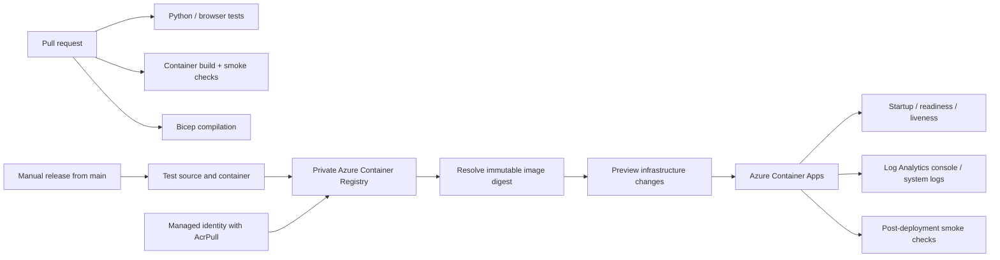

# Runbook Search: container and Azure operations lab

A small retrieval service with a tested release path. This lab adds container packaging, Azure infrastructure as code, a manual deployment workflow, health probes, request metrics and an incident/rollback guide to the existing search project.

**Deployment status:** GitHub Pages serves the static browser demo. The container/API is a separate deployment target. Azure resources have not been provisioned or tested in a subscription. Template compilation is not evidence of a successful cloud deployment.

## Architecture



The browser UI searches locally in JavaScript; `/api/search` is an independent Python endpoint. There are no model calls, uploads, credentials or real operational documents in the demo.

## Local container

Requires Docker. From the repository root:

```sh
docker build -t runbook-search:local .
docker run -d --name runbook-search --read-only --cap-drop ALL \
  --security-opt no-new-privileges --tmpfs /tmp:rw,noexec,nosuid,size=16m \
  -p 127.0.0.1:8000:8000 runbook-search:local
python3 smoke_test.py http://127.0.0.1:8000
docker logs runbook-search
docker rm -f runbook-search
```

The image runs Gunicorn as UID/GID 10001, with one process and four threads. Only the explicit application assets and synthetic runbooks enter the build context. The CLI remains dependency-free; the container adds pinned Gunicorn and packaging dependencies. The Python base image tag is intentionally readable but mutable; pin its digest for a controlled release and maintain dependency updates.

The read-only root filesystem and dropped capabilities above are exercised in CI. The Azure template does not claim to enforce the identical Docker runtime flags. TLS terminates at Container Apps ingress. This is a public synthetic-data lab, with no application authentication or rate limiting; private runbooks require a different access design.

## Azure prerequisites and cost

Use a **dedicated disposable resource group**, an Azure subscription, Azure CLI with Bicep, and a region supporting Container Apps. Do not run these commands until you have chosen a budget and reviewed the public endpoint and identity permissions.

The template limits the app to zero-to-one replicas with 0.25 vCPU / 0.5 GiB, but this is **not a spending cap**. ACR Basic, log ingestion/storage, networking and active container usage can incur charges. The 1 GB/day log ingestion setting is a soft operational limit, not a financial guarantee. Set a subscription/resource-group cost budget in Azure and remove the lab when finished. Cold starts are expected at zero replicas.

Register the Microsoft.App, Microsoft.OperationalInsights, Microsoft.ContainerRegistry and Microsoft.ManagedIdentity providers in the subscription if necessary. Provider registration may require a subscription administrator.

### 1. Bootstrap registry and pull identity

Run as an operator authorized to create resources and role assignments in the dedicated group. Use a globally unique lowercase alphanumeric registry name. The registry has no admin password; the user-assigned identity receives **AcrPull scoped only to that registry**. Role propagation can take time.

```sh
az login
# Verify the selected subscription before creating anything.
az account show --query '{name:name,id:id}' -o table
RG=runbook-search-lab
LOCATION=eastus
REGISTRY=replacewithuniquename
az group create --name "$RG" --location "$LOCATION" --tags purpose=portfolio-lab
az deployment group what-if --resource-group "$RG" --template-file registry.bicep \
  --parameters registryName="$REGISTRY"
az deployment group create --name registry-bootstrap --resource-group "$RG" \
  --template-file registry.bicep --parameters registryName="$REGISTRY"
az deployment group show --resource-group "$RG" --name registry-bootstrap \
  --query properties.outputs
```

Record the `pullIdentityId` output. Do not commit account IDs, tokens, credentials, deployment outputs or real logs to this repository.

### 2. Configure release authentication

Create a dedicated Azure deployment identity and a federated credential for GitHub's OIDC issuer `https://token.actions.githubusercontent.com`, audience `api://AzureADTokenExchange`, subject `repo:VasaviKosaraju1/runbook-search:environment:azure-lab`. This is an explicit cloud-access grant and should be reviewed by the account owner.

For this isolated lab, the deployment identity needs **Contributor on the dedicated resource group**, including registry image push and managed-identity assignment to the app. Do not assign subscription-wide Owner or Contributor. It does not create role assignments; that is the bootstrap operator's responsibility. The supplied ACR uses classic registry RBAC, not ABAC repository permissions.

Create the GitHub environment `azure-lab`, restrict it to `main`, and configure required-reviewer approval where your account/plan supports it. The workflow is manually dispatched and refuses other branches. Before dispatching, review the source commit and permissions. Environment approval is before the job; the `what-if` output is a recorded preview, **not an interactive pause before apply**. To review a preview before permitting changes, run the same `what-if` command locally first.

Environment secrets:

- `AZURE_CLIENT_ID`
- `AZURE_TENANT_ID`
- `AZURE_SUBSCRIPTION_ID`

Environment variables:

- `AZURE_RESOURCE_GROUP`: dedicated group name
- `AZURE_REGISTRY_NAME`: registry name, not its full hostname
- `AZURE_PULL_IDENTITY_ID`: bootstrap identity resource ID

The workflow uses short-lived OIDC authentication; it does not require a client secret. These prerequisites have deliberately not been configured by this repository change.

### 3. Release

In Actions, select **Deploy Azure lab → Run workflow → main**. The workflow:

1. Runs the source tests and checks generated fixtures.
2. Builds and smoke-tests the container with a read-only filesystem.
3. Pushes that same tested image to ACR with commit/run identifiers.
4. Resolves its SHA-256 digest and deploys `registry/repository@sha256:...`.
5. Creates/updates the app environment, log workspace and service from `main.bicep`.
6. Checks the HTTPS readiness, API, metrics and private-path behavior.
7. Records the commit, image digest and endpoint in the run summary.

A green source/container check is required evidence before release. A failed cloud smoke check leaves the new deployment in place and marks the run failed; there is no automatic rollback. Inspect it and use the rollback procedure below. The Azure resource manager can reject an otherwise compiled template because of quota, regional availability, RBAC or policy; the first deployment must verify these assumptions.

## Monitoring and incident checks

`GET /health` reports readiness and chunk count; an empty corpus returns 503. The template configures startup, readiness and liveness probes. `GET /metrics` exposes Prometheus text counters by fixed route and status, plus cumulative request duration. Metrics are in-memory, single-worker, per-replica, reset on restart and exclude metric scrapes. They do not provide fleet-wide history or percentile latency. No Prometheus collector is provisioned.

Application request records go to stdout as JSON: event, allowlisted route, status, duration_ms. Query strings, arbitrary URL paths and result text are excluded from these application logs. Gunicorn access logging is disabled; infrastructure logs may have their own retention and privacy behavior.

Open the created workspace's Logs view and run the two queries in `monitoring.kql` separately. Replace the app name if changed. The first reports five-minute request/error counts and p95 application duration; the second helps diagnose revision/startup failures. Application duration excludes network transit, queueing and proxy overhead. JSON log processing and alert delivery still need validation in an Azure subscription.

Suggested lab alert: more than five HTTP 5xx application records in five minutes, evaluated every five minutes. Create a scheduled-query alert from the first query filtered to `status >= 500`, and choose a real action group/contact yourself. No alert recipient or paid alert rule is created by the template. For a zero-replica service, absence of traffic is not proof of downtime; use an external HTTPS availability check if continuous availability is required.

Incident sequence:

1. Run `python3 smoke_test.py https://YOUR_APP_FQDN` and check `/health`.
2. Inspect Container Apps system logs for pull failures, crashes, quota and probe failures.
3. Check the latest workflow summary's commit/digest and application error counts.
4. If image pulls fail, verify the registry-scoped AcrPull assignment and identity, then allow for RBAC propagation. Do not enable registry admin credentials as a workaround.
5. Roll back if the regression matches the new release. Keep a brief issue with the observed symptom, fix and verification.

## Rollback

Keep the previous successful run's **full image digest reference**. Set `PREVIOUS_IMAGE` to that exact reference, then update the app. Do not use `latest`. This changes the service's desired image; the next normal workflow deploys its current source again.

```sh
RG=runbook-search-lab
PREVIOUS_IMAGE='YOUR_REGISTRY.azurecr.io/runbook-search@sha256:PREVIOUS_DIGEST'
az containerapp update --resource-group "$RG" --name runbook-search --image "$PREVIOUS_IMAGE"
az containerapp show --resource-group "$RG" --name runbook-search \
  --query properties.configuration.ingress.fqdn -o tsv
python3 smoke_test.py https://YOUR_APP_FQDN
```

Single-revision mode keeps one active revision. This is a simple roll-forward-to-a-known-image procedure, not a tested zero-downtime or automated canary strategy. Retain prior images until the rollback window has passed.

## Cleanup

First verify the group contains only this disposable lab. Deleting it removes the app, environment, registry, images, identity and log workspace. This is destructive; the operator must review and confirm it.

```sh
RG=runbook-search-lab
az resource list --resource-group "$RG" --query '[].{name:name,type:type}' -o table
az group delete --name "$RG"
```

Also remove the dedicated deployment identity/federated credential and GitHub environment configuration if no longer needed; they may exist outside the resource group. Review Azure Cost Management afterward for remaining usage. GitHub Pages is independent and remains available.

## Design tradeoffs and next evidence

- One app, one worker and bounded replica count keep the lab understandable; no HA, load-test or production SLO claim.
- Managed-identity pulls avoid registry passwords; OIDC avoids a stored cloud client secret.
- Explicit asset copies and a restrictive build context reduce accidental file publication.
- Compilation and container tests are automated. Actual Azure deploy/rollback, cost observations and alert delivery are still pending. Add a dated release record only after observing them.
- Add image/dependency vulnerability scanning, digest-pinned base images and action commit pinning before treating this as a controlled production release process.

References: [Azure OIDC setup](https://learn.microsoft.com/en-us/azure/developer/github/connect-from-azure-openid-connect), [Container Apps GitHub Actions](https://learn.microsoft.com/en-us/azure/container-apps/github-actions), [Container Apps logs](https://learn.microsoft.com/en-us/azure/container-apps/log-monitoring), [Bicep resource reference](https://learn.microsoft.com/en-us/azure/templates/microsoft.app/2024-03-01/containerapps), [Gunicorn](https://gunicorn.org/).
