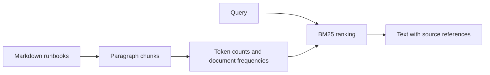

# Runbook Search

[Try the live browser demo](https://vasavikosaraju1.github.io/runbook-search/) · [Source and tests](https://github.com/VasaviKosaraju1/runbook-search)

Search operational notes through a local CLI, a browser demo, or a Python API.

**DevOps deployment lab:** [container, Azure infrastructure, CI/CD, monitoring, rollback and cleanup](OPERATIONS.md). The static demo is live; Azure deployment is prepared but has not been provisioned in a subscription.

This is a small, dependency-free retrieval baseline for Markdown runbooks. It ranks paragraph-sized chunks with BM25 and returns the source filename and chunk number alongside the text. It is useful for checking whether a document collection can answer common operational questions before adding embeddings or generated answers.

## Try it

Requires Python 3.11 or newer. No API key, account, or package installation is needed.

```sh
python3 search.py "OOMKilled memory limit"
python3 search.py --evaluate evaluation.json
python3 -m unittest -v
```

A nonexistent document directory is rejected with exit status 2 and a JSON error on stderr. An existing empty directory is valid and returns no results.

The first query returns the memory-pressure runbook. An unknown term returns an empty list rather than an invented answer.

## Browser demo and local API

```sh
python3 build_demo.py
python3 app.py
```

Open `http://127.0.0.1:8000`. The interface loads the checked-in synthetic dataset and performs BM25 search in the browser. No model calls or user document uploads are involved.

The local server also provides:

- `GET /health`: reports service readiness and indexed chunk count.
- `GET /api/search?q=memory&limit=3`: returns ranked passages as JSON.
- Invalid or empty queries and invalid limits return HTTP 400.
- Unmatched queries return HTTP 200 with an empty result list.

The server binds to loopback by default, suppresses request logs, and serves only the demo assets. It is a development server, not a production deployment target. The browser UI uses the JavaScript index; the local API uses the Python index. Golden cases verify consistent ranking and scores between the two implementations.

### Static deployment

The static demo consists of `index.html`, `web.js`, and `runbooks.json`. GitHub Pages can publish it directly from `main` at the repository root. The Python API and `/health` endpoint run locally; GitHub Pages does not execute Python. Rebuild `runbooks.json` after changing the synthetic runbooks and include that generated file in the commit.

### Browser retrieval checks

Requires Node.js 22 or newer for the test command only; the published demo runs in a modern browser without Node.

```sh
node web.test.cjs
```

The checks cover tokenization, relevant results, unmatched and blank queries, invalid limits, deterministic ties, and 18 golden comparisons against Python. `browser-parity.json` contains fixed expected results; update it deliberately when ranking behavior changes.

## How it works



The index reads `runbook-*.md` files from the current directory, or a directory supplied with `--docs`. Blank-line-separated paragraphs are independent retrieval units. Tokenization lowercases text and keeps ASCII letters and digits. Ranking uses BM25 with k1=1.2 and b=0.75; ties are sorted by source for reproducible output. Query terms are deduplicated. The top three positive-scoring chunks are returned.

## Evaluation

`evaluation.json` contains six hand-written queries over three synthetic runbooks. The evaluation reports hit rate and mean reciprocal rank at three. A hit means that a returned chunk comes from the expected file. Run the command above to reproduce the figures in [VALIDATION.md](VALIDATION.md).

### Challenge evaluation

```sh
python3 evaluate_challenge.py
python3 evaluate_challenge.py > evaluation-results.json
```

`evaluation-challenge.json` adds explicit case identifiers, categories, and relevance labels. It includes the original six queries, six paraphrased questions, and six irrelevant questions. Irrelevant cases use `expected_source: null`; missing labels are rejected rather than treated as no-answer cases. The report includes per-query rankings and category-level metrics. Unknown source labels and duplicate case identifiers are rejected.

| Category | Cases | Hit rate at 3 | MRR at 3 | Correct no-results responses |
| --- | ---: | ---: | ---: | ---: |
| Baseline | 6 | 1.00 | 1.00 | Not applicable |
| Paraphrase | 6 | 1.00 | 1.00 | Not applicable |
| Irrelevant | 6 | Not applicable | Not applicable | 2 of 6 |

The baseline incorrectly returns results for **4 of 6 irrelevant queries**. Some unrelated questions share ordinary words with the runbooks, so lexical overlap alone does not establish that a passage answers the question. The challenge set exposes this behavior without changing the ranking algorithm or hiding failures. See [evaluation-results.json](evaluation-results.json) for all queries and returned passages.

Positive-query metrics are calculated only over cases with a relevant source. The irrelevant-query false-positive rate counts any returned passage for an irrelevant case; correct abstention means returning no passages. A metric with no applicable cases is reported as null, not zero.

This is a small, manually authored challenge set over three synthetic runbooks. It is not a blind held-out benchmark and does not establish general retrieval quality. File-level hits can also be easier than passage-level relevance judgments. A larger independent query set, more documents, and human passage-level labels are needed before making broader claims.

## Decisions and limitations

- BM25 makes the baseline easy to inspect and run offline. It does not understand synonyms or infer meaning.
- Source references identify local files and chunk numbers, not permanent line anchors. Editing a file can change chunk numbers.
- The index is rebuilt in memory for each invocation. Large collections need persistence and incremental indexing.
- There is no generative model or authentication. The browser demo is static. `app.py` is for local development; `cloud_app.py` provides the separate Gunicorn container target. Neither should be used to publish private runbooks.
- Sample runbooks are fictional learning fixtures. Check actual operational procedures before using them.

## Files worth reading

`search.py` contains retrieval and evaluation. `test_search.py` covers ranking, empty input, missing vocabulary, limits, deterministic ties, and metrics. The three `runbook-*.md` files and `evaluation.json` make the example reproducible.

## Next steps

Compare lexical retrieval with an embedding baseline on a larger held-out dataset; measure latency and retrieval quality before adding answer generation. Any generated answer should cite retrieved passages and decline unsupported questions.

MIT licensed.
