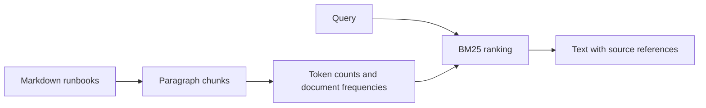

# Runbook Search

Find relevant operational notes before reaching for a language model.

This is a small, dependency-free retrieval baseline for Markdown runbooks. It ranks paragraph-sized chunks with BM25 and returns the source filename and chunk number alongside the text. It is useful for checking whether a document collection can answer common operational questions before adding embeddings or generated answers.

## Try it

Requires Python 3.11 or newer. No API key, account, or package installation is needed.

```sh
python3 search.py "OOMKilled memory limit"
python3 search.py --evaluate evaluation.json
python3 -m unittest -v
```

A nonexistent document directory is rejected with exit status 2 and a JSON error on stderr. An existing empty directory is valid and returns no results.

The first query returns the memory-pressure runbook. An unknown term returns an empty list rather than an invented answer.

## How it works



The index reads `runbook-*.md` files from the current directory, or a directory supplied with `--docs`. Blank-line-separated paragraphs are independent retrieval units. Tokenization lowercases text and keeps ASCII letters and digits. Ranking uses BM25 with k1=1.2 and b=0.75; ties are sorted by source for reproducible output. Query terms are deduplicated. The top three positive-scoring chunks are returned.

## Evaluation

`evaluation.json` contains six hand-written queries over three synthetic runbooks. The evaluation reports hit rate and mean reciprocal rank at three. A hit means that a returned chunk comes from the expected file. Run the command above to reproduce the figures in [VALIDATION.md](VALIDATION.md).

This is a smoke-test corpus, not evidence of general retrieval quality. The queries closely match the sample vocabulary. A useful next evaluation would include paraphrases, ambiguous questions, and irrelevant documents, with a separate held-out query set.

## Decisions and limitations

- BM25 makes the baseline easy to inspect and run offline. It does not understand synonyms or infer meaning.
- Source references identify local files and chunk numbers, not permanent line anchors. Editing a file can change chunk numbers.
- The index is rebuilt in memory for each invocation. Large collections need persistence and incremental indexing.
- There is no generative model, web service, authentication, or production deployment in this version.
- Sample runbooks are fictional learning fixtures. Check actual operational procedures before using them.

## Files worth reading

`search.py` contains retrieval and evaluation. `test_search.py` covers ranking, empty input, missing vocabulary, limits, deterministic ties, and metrics. The three `runbook-*.md` files and `evaluation.json` make the example reproducible.

## Next steps

Compare lexical retrieval with an embedding baseline on a larger held-out dataset; measure latency and retrieval quality before adding answer generation. Any generated answer should cite retrieved passages and decline unsupported questions.

MIT licensed.
